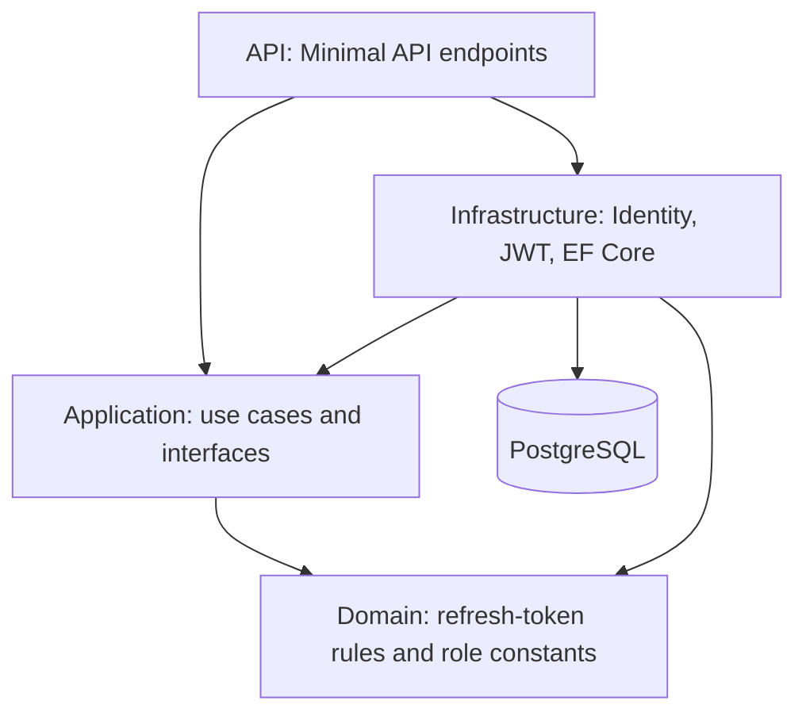

# IdentityHub

A .NET 10 authentication API covering registration, JWT access tokens and renewable refresh-token sessions. The main focus is the refresh-token lifecycle: rotation on every refresh, reuse detection, a sliding window with an absolute session cap, and revocation across multiple logins.

The solution uses a layered architecture (API, Application, Domain, Infrastructure), PostgreSQL via EF Core, Docker Compose for local development, 49 unit and integration tests, and a GitHub Actions build-and-test pipeline.

## Key engineering decisions

- **Refresh-token reuse detection.** Presenting a revoked refresh token revokes every active session for that user, on the assumption that the token has been stolen.
- **Sliding expiry with an absolute cap.** Each refresh extends the session, but never past 30 days from the original login. `SessionStartedAt` is carried through every rotation to enforce this.
- **Token rules live in the domain.** `RefreshToken` owns issuance, expiry and revocation logic, and the Domain project has no external package dependencies.
- **Injected time.** Use cases and token generation take `TimeProvider`, so expiry scenarios are tested with a fixed clock.
- **Atomic rotation.** Revoking the old token and adding its replacement is saved in a single `SaveChangesAsync` call.

## Quick start

Requires Docker with Compose v2.

```bash
docker compose up --build -d postgres api
```

The API runs at `http://localhost:8080`, with the OpenAPI document at `http://localhost:8080/openapi/v1.json`. Migrations and role seeding run on startup.

## Architecture



| Project | Responsibility |
| --- | --- |
| `IdentityHub.API` | Request/response contracts, endpoint mapping, authentication middleware, error mapping, startup |
| `IdentityHub.Application` | Register, login, refresh, logout and logout-all use cases; service and repository interfaces; result types and options |
| `IdentityHub.Domain` | Refresh-token issuance, expiry and revocation rules; role constants |
| `IdentityHub.Infrastructure` | ASP.NET Core Identity adapter, JWT generation and validation, EF Core repositories, migrations, role seeding |

Use cases depend on `IIdentityService`, `ITokenService` and `IRefreshTokenRepository`, which Infrastructure implements. Endpoints map use-case results to HTTP responses.

## Features

- Registration through ASP.NET Core Identity, with the default `User` role assigned
- Email and password login returning a JWT access token and an opaque refresh token
- Refresh-token rotation, reuse detection and an absolute session limit
- Logout of a single session, or of all sessions for the authenticated user
- `/users/me` returning the current user's ID, email and roles from the token
- Validation problems and Problem Details responses for failures
- OpenAPI document in Development

## How authentication works

### Credentials and roles

ASP.NET Core Identity stores users and password hashes. The password policy requires at least 12 characters, with uppercase, lowercase, a digit, a non-alphanumeric character and at least two unique characters.

The email address is used as both username and email. `User` and `Admin` roles are seeded at startup; registration always assigns `User`. If role assignment fails, the newly created user is deleted.

### Access tokens

Access tokens are signed with HMAC-SHA256 and carry `sub`, `email`, `jti` and `role` claims. Validation checks issuer, audience, signing key and lifetime, accepts only HMAC-SHA256, and uses zero clock skew. Inbound claim mapping is disabled so endpoints read the original claim names.

### Refresh-token rotation

Refresh tokens are 64 cryptographically random bytes, Base64-encoded. Each login starts a new session with its own token record.

On refresh:

1. Reject the token if it is unknown, revoked, expired or past the absolute session limit.
2. Load the user's current email and roles and generate a new token pair.
3. Carry `SessionStartedAt` over to the replacement token.
4. Revoke the old token and record the replacement in `ReplacedByToken`.
5. Save both changes in one `SaveChangesAsync` call.

The replacement's expiry is:

```text
min(now + RefreshTokenLifetimeDays,
    SessionStartedAt + AbsoluteRefreshTokenLifetimeDays)
```

Development defaults: 15-minute access tokens, a 7-day refresh window and a 30-day absolute session limit.

### Reuse detection

If a revoked refresh token is submitted to `/auth/refresh`, all active refresh tokens for that user are revoked across every session, the revocations are saved, and the request returns `401`. This applies to tokens revoked by logout as well as by rotation, so a client should always discard its old refresh token after a successful refresh.

Unknown, expired and revoked refresh tokens all return the same error code (`Tokens.InvalidRefreshToken`), and unknown users and wrong passwords both return `Users.InvalidCredentials`, so responses don't reveal which case occurred.

### Logout

| Endpoint | Behaviour |
| --- | --- |
| `POST /auth/logout` | Revokes the submitted refresh token. Unknown or already revoked tokens are a no-op. Always returns `204`. |
| `POST /auth/logout-all` | Requires a bearer token. Revokes every active refresh token for the `sub` user in one save. Returns `204`. |

Access tokens are not denylisted, so an issued access token stays valid until it expires (15 minutes by default). Logout ends the renewable session.

## API endpoints

JSON uses camel case. Protected endpoints take `Authorization: Bearer <accessToken>`.

| Method | Path | Auth | Request | Responses |
| --- | --- | --- | --- | --- |
| `POST` | `/auth/register` | None | `email`, `password` | `201` with `userId`; `400` validation problem |
| `POST` | `/auth/login` | None | `email`, `password` | `200` token pair; `401` invalid credentials |
| `POST` | `/auth/refresh` | Refresh token in body | `refreshToken` | `200` new token pair; `401` rejected refresh |
| `POST` | `/auth/logout` | Refresh token in body | `refreshToken` | `204` |
| `POST` | `/auth/logout-all` | Bearer | None | `204`; `401` unauthenticated |
| `GET` | `/users/me` | Bearer | None | `200` with `userId`, `email`, `roles`; `401` unauthenticated |
| `GET` | `/openapi/v1.json` | None | None | OpenAPI document (Development only) |

Login and refresh response:

```json
{
  "accessToken": "<JWT>",
  "refreshToken": "<opaque refresh token>",
  "accessTokenExpiresInSeconds": 900,
  "refreshTokenExpiresInSeconds": 604800,
  "tokenType": "Bearer"
}
```

Near the absolute session limit, `refreshTokenExpiresInSeconds` on a refresh will be shorter than the full window. Login and refresh failures include an `errorCodes` array in the Problem Details body.

## Running locally

Run commands from the repository root.

### API and database in Docker

```bash
docker compose up --build -d postgres api
docker compose logs -f api
docker compose down
```

Data persists in the `identityhub-pgdata` volume.

### API on the host, database in Docker

Requires the .NET 10 SDK.

```bash
docker compose up -d postgres
dotnet run --project src/IdentityHub.API --launch-profile http
```

The `http` profile serves the API at `http://localhost:5022`. Example requests are in `src/IdentityHub.API/IdentityHub.API.http`; the environment file `http-client.env.json` points at port `8080`, so change it to `5022` for this option.

### Configuration

| Setting | Development value |
| --- | --- |
| Database | `localhost:5432`, database `identityhub` |
| Test database | `localhost:5433`, database `identityhubtest` |
| Database credentials | `postgres` / `postgres` |
| Connection string key | `ConnectionStrings:Default` |
| JWT issuer / audience | `IdentityHub` / `IdentityHub.Clients` |
| JWT secret key | `Authentication:Jwt:Secret` |

Development settings are in `src/IdentityHub.API/appsettings.Development.json`. Override them with environment variables such as `ConnectionStrings__Default` and `Authentication__Jwt__Secret`. Outside Development, the database and JWT settings must be supplied; startup validation requires a JWT secret of at least 32 characters and checks token lifetimes are in range. The committed secret and credentials are for local development only.

Migrations run on startup. To apply them manually:

```bash
dotnet tool restore
ASPNETCORE_ENVIRONMENT=Development dotnet ef database update \
  --project src/IdentityHub.Infrastructure \
  --startup-project src/IdentityHub.API
```

### Try it

Use port `8080` for Docker or `5022` for the host profile.

```bash
curl -i http://localhost:8080/auth/register \
  -H 'Content-Type: application/json' \
  -d '{"email":"demo@example.com","password":"DemoPassword123!"}'

curl -s http://localhost:8080/auth/login \
  -H 'Content-Type: application/json' \
  -d '{"email":"demo@example.com","password":"DemoPassword123!"}'
```

Then use the returned tokens:

```bash
curl http://localhost:8080/users/me \
  -H 'Authorization: Bearer <accessToken>'

curl http://localhost:8080/auth/refresh \
  -H 'Content-Type: application/json' \
  -d '{"refreshToken":"<refreshToken>"}'

curl -i -X POST http://localhost:8080/auth/logout-all \
  -H 'Authorization: Bearer <accessToken>'
```

## Testing

49 xUnit tests across four projects:

| Project | Tests | Focus |
| --- | ---: | --- |
| `IdentityHub.Domain.Tests` | 7 | Refresh-token issuance guards, state and revocation |
| `IdentityHub.Application.Tests` | 20 | Login, rotation, expiry, absolute session limit, reuse detection, logout and logout-all |
| `IdentityHub.Infrastructure.Tests` | 4 | JWT claims, issuer/audience/signature, expiry and refresh-token format |
| `IdentityHub.API.Tests` | 18 | End-to-end HTTP flows: registration, login, refresh, logout, protected endpoints, reuse invalidating a replacement token, logout across two sessions |

The API tests run against a real PostgreSQL database through `WebApplicationFactory`. They use the dedicated `postgres-test` service on port `5433`, and clear user data on startup, so don't point them at another database.

```bash
docker compose up -d postgres-test
dotnet test IdentityHub.slnx
```

Unit tests only (no database needed):

```bash
dotnet test tests/IdentityHub.Domain.Tests
dotnet test tests/IdentityHub.Application.Tests
dotnet test tests/IdentityHub.Infrastructure.Tests
```

Coverage:

```bash
dotnet test IdentityHub.slnx --collect:"XPlat Code Coverage"
```

## Continuous integration

GitHub Actions (`.github/workflows/ci.yml`) runs on every push and pull request to `main`. It starts a `postgres:18-alpine` service on port `5433`, then restores, builds in Release and runs the full test suite.

## Tech stack

| Area | Technology |
| --- | --- |
| Runtime and API | C#, .NET 10, ASP.NET Core Minimal APIs |
| Users and roles | ASP.NET Core Identity with GUID keys |
| Persistence | EF Core 10, Npgsql, PostgreSQL 18 |
| Tokens | JWT bearer authentication, Microsoft.IdentityModel.JsonWebTokens, HMAC-SHA256 |
| API description | ASP.NET Core OpenAPI |
| Tests | xUnit, NSubstitute, WebApplicationFactory, Coverlet |
| Build and CI | Multi-stage Dockerfile, Docker Compose, GitHub Actions |

## Project structure

```text
src/
  IdentityHub.API/
    Endpoints/Auth/          # Auth contracts and routes
    Endpoints/Users/         # Current-user endpoint
    Common/Extensions/       # Claim extraction
  IdentityHub.Application/
    Features/                # Register, Login, RefreshTokens, Logout, LogoutAll
    Common/                  # Interfaces, options, results, errors
  IdentityHub.Domain/
    Entities/RefreshToken.cs # Session and token rules
    Constants/UserRoles.cs
  IdentityHub.Infrastructure/
    Identity/                # Identity adapter and JWT services
    Persistence/             # DbContext, repository, mappings, migrations
tests/
  IdentityHub.API.Tests/
  IdentityHub.Application.Tests/
  IdentityHub.Domain.Tests/
  IdentityHub.Infrastructure.Tests/
```

## Roadmap

Planned next:

- Hash refresh tokens at rest (SHA-256) instead of storing raw values
- Add a concurrency token to rotation so two simultaneous refreshes of the same token can't both succeed
- Account lockout after repeated failed logins, and rate limiting on the auth endpoints
- A cleanup job for expired and revoked tokens

Out of scope for this project: email confirmation, password reset, MFA, external login providers, role administration endpoints and an OAuth/OIDC server.

## License

[MIT](LICENSE) — Copyright © 2026 Juha Anttila.
